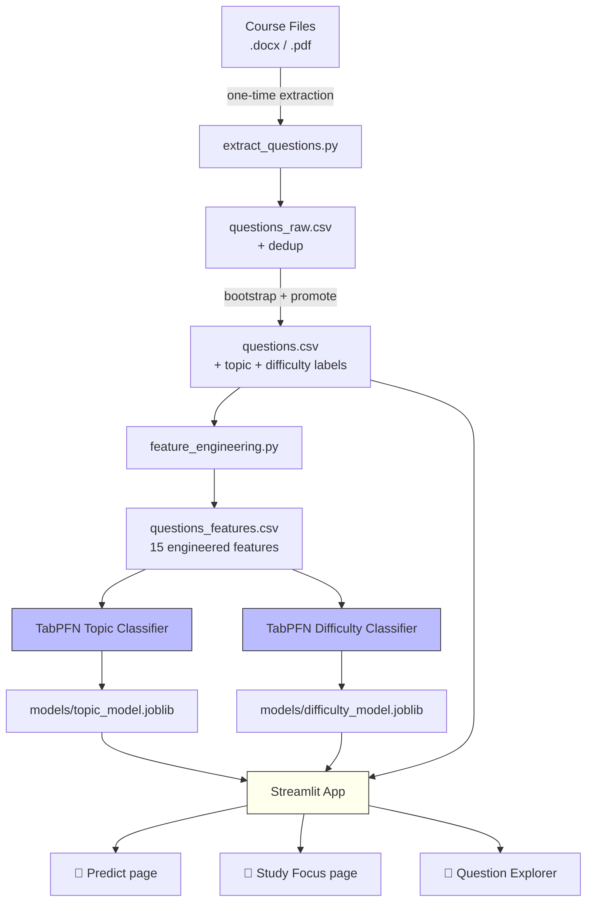
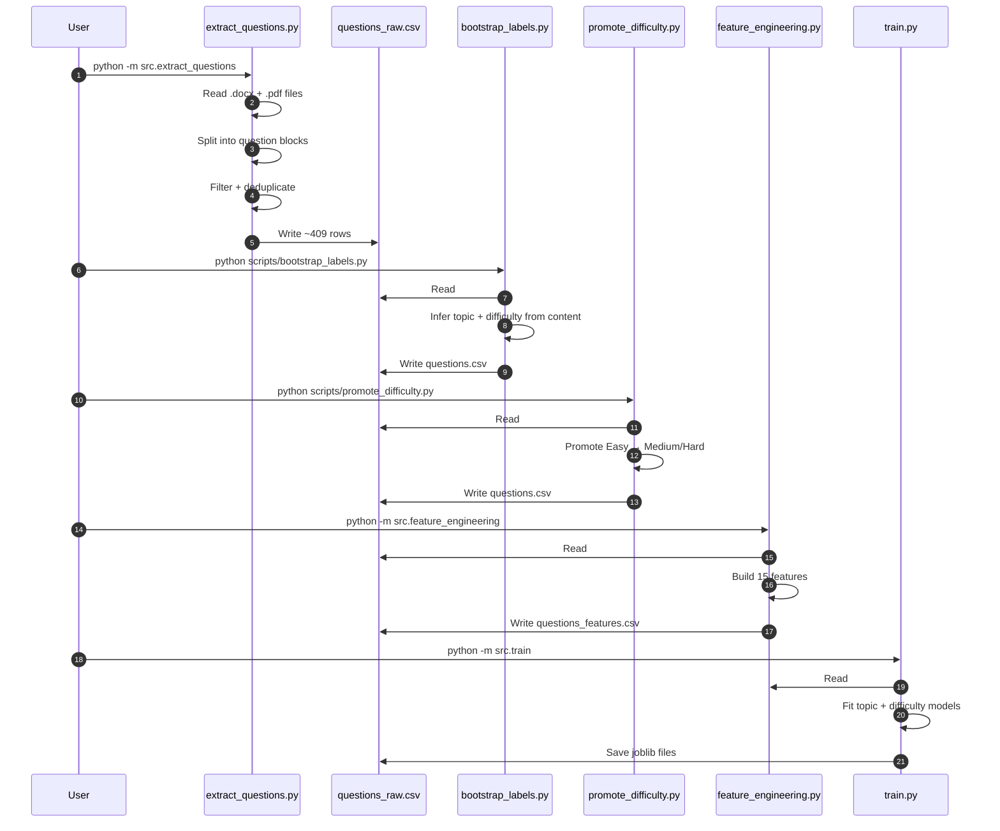
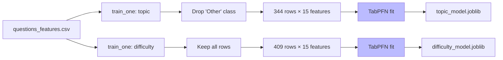
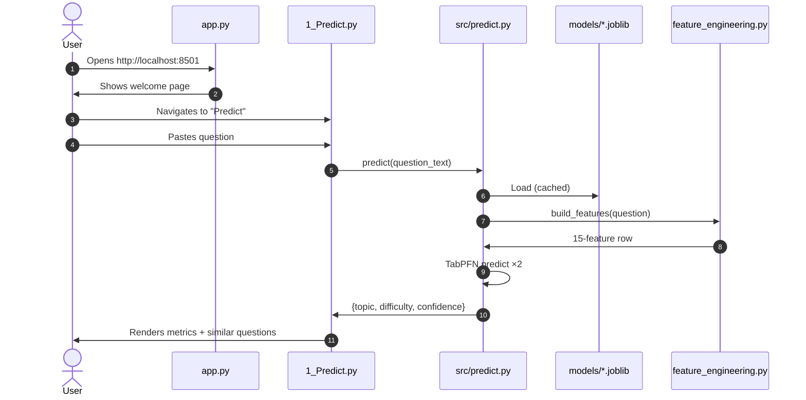

# Design & Testing — Last-Minute-Prep

Deep technical documentation for the **Last-Minute-Prep** project: a TabPFN-powered study companion built for a friend preparing for the Ghana Surveyors Licensing Examination.

---

## 📑 Table of Contents

1. [Executive Summary](#-executive-summary)
2. [Tech Stack](#-tech-stack)
3. [System Architecture](#-system-architecture)
   - [High-Level Architecture](#high-level-architecture)
   - [Data Pipeline Flow](#data-pipeline-flow)
   - [ML Training Flow](#ml-training-flow)
   - [Streamlit App Flow](#streamlit-app-flow)
4. [Project Structure](#-project-structure)
5. [File-by-File Description](#-file-by-file-description)
6. [Data Pipeline](#-data-pipeline)
7. [Feature Engineering](#-feature-engineering)
8. [Model Design](#-model-design)
9. [The Streamlit App](#-the-streamlit-app)
10. [Testing Strategy](#-testing-strategy)
11. [Challenges & Solutions](#-challenges--solutions)
12. [Known Limitations](#-known-limitations)
13. [Future Work](#-future-work)
14. [License & Attribution](#-license--attribution)

---

## 🎯 Executive Summary

**Problem:** A fellow candidate for the Ghana Surveyors Licensing Board Examination has 400+ practice questions scattered across 30+ `.docx` and `.pdf` files, with no way to know which topics she's weakest in or which questions are hardest.

**Solution:** An offline-first study companion that uses **TabPFN** (an open-weight tabular foundation model) to classify every question by **topic** and **difficulty**, and surfaces a personalised "study focus" dashboard.

**Key decisions:**

- **Open model, not closed API.** Exam content never leaves the laptop.
- **Zero fine-tuning.** TabPFN works zero-shot on ~400 rows — no GPU required.
- **Iterative extraction.** The extractor went through 6 iterations to handle heterogeneous documents (Q&A sheets, statutes, court judgments, lectures).
- **Feature-first approach.** Adding 6 topic-keyword features doubled topic classification accuracy.

**Results:**

- **409 clean, deduplicated questions** from 17 source files
- **Topic classifier:** 84.1% accuracy, 0.668 macro-F1
- **Difficulty classifier:** 64.6% accuracy, 0.530 macro-F1
- **Zero cost, zero API keys, 100% offline after first download**

---

## 🛠️ Tech Stack

### Core AI

| Technology | Version | Purpose |
|---|---|---|
| **TabPFN** | v2.5 | Open-weight tabular foundation model — the heart of the predictor |
| **PyTorch** | 2.2.2 | Backend tensor runtime for TabPFN |
| **scikit-learn** | 1.5.2 | Train/test split, metrics |

### Data Pipeline

| Technology | Version | Purpose |
|---|---|---|
| **pandas** | 3.0.6 | CSV ingestion and feature engineering |
| **NumPy** | 1.26.4 | Numerical operations |
| **python-docx** | 1.1+ | Parse `.docx` course files |
| **pypdf** | 4+ | Parse `.pdf` course files |
| **joblib** | 1.6 | Serialise trained models |

### UI

| Technology | Version | Purpose |
|---|---|---|
| **Streamlit** | 1.64 | Local web app framework |
| **Plotly** | 7.1 | Interactive charts |

### Development

| Technology | Purpose |
|---|---|
| **pytest** | Unit testing |
| **black** | Code formatting |
| **ruff** | Linting |

**Note on versions:** NumPy is pinned to 1.x because current PyTorch wheels are compiled against NumPy 1.x. SciPy and scikit-learn are pinned to versions compatible with NumPy 1.26. See [Challenges](#-challenges--solutions) for details.

---

## 🏛️ System Architecture

### High-Level Architecture



### Data Pipeline Flow



### ML Training Flow



### Streamlit App Flow



---

## 📁 Project Structure

```
last-minute-prep/
├── .env.example
├── .gitignore
├── LICENSE
├── README.md
├── pyproject.toml
├── requirements.txt
│
├── data/
│   ├── README.md
│   ├── raw/                              # 🔒 private
│   │   ├── ETHICS QnA.docx
│   │   ├── INSTRUMENTATION AND THE LICENSED SURVEYOR.docx
│   │   ├── Ethics/
│   │   ├── LS-COURSE-NOTES/
│   │   ├── Land Dispute/
│   │   ├── ORAL INTERVIEW/
│   │   ├── PHOTOGRAMMETRY/
│   │   └── TECHNICAL GUIDELINES/
│   ├── interim/
│   │   └── questions_raw.csv             # machine output
│   └── processed/
│       ├── questions.csv                 # 🔒 hand-reviewed labels
│       ├── questions_sample.csv          # public 10-row sample
│       └── questions_features.csv        # 15-feature matrix
│
├── models/
│   ├── topic_model.joblib                # 🔒
│   ├── difficulty_model.joblib           # 🔒
│   └── README.md
│
├── src/
│   ├── __init__.py
│   ├── config.py
│   ├── utils.py
│   ├── extract_questions.py
│   ├── feature_engineering.py
│   ├── train.py
│   ├── predict.py
│   └── evaluate.py
│
├── app/
│   ├── app.py
│   ├── pages/
│   │   ├── 1_Predict.py
│   │   ├── 2_Study_Focus.py
│   │   └── 3_Question_Explorer.py
│   └── assets/
│       └── style.css
│
├── scripts/
│   ├── bootstrap_labels.py
│   ├── promote_difficulty.py
│   ├── run_pipeline.sh
│   ├── add_questions.sh
│   ├── run_extraction.sh
│   ├── run_training.sh
│   └── run_app.sh
│
├── tests/
│   ├── __init__.py
│   ├── test_extract.py
│   ├── test_feature_engineering.py
│   └── test_predict.py
│
├── notebooks/
│   └── 01_data_exploration.ipynb
│
└── docs/
    └── Design-And-Testing.md             # this file
```

---

## 📜 File-by-File Description

### Root Configuration

| File | Purpose |
|---|---|
| `README.md` | Project overview, quick start, and story |
| `LICENSE` | Apache-2.0 licence text |
| `requirements.txt` | Pinned direct dependencies (NumPy 1.x stack) |
| `pyproject.toml` | Project metadata and tool config (black, ruff, pytest) |
| `.gitignore` | Excludes private data, model binaries, and virtualenv |
| `.env.example` | Template for optional env vars |

### Source (`src/`)

| File | Purpose |
|---|---|
| `config.py` | Paths, label maps, feature column list, exclusion list, TabPFN settings |
| `utils.py` | `clean_text()`, `setup_logger()`, `ensure_parent()` |
| `extract_questions.py` | Reads `.docx` and `.pdf`, splits into question blocks, filters, deduplicates, writes `questions_raw.csv` |
| `feature_engineering.py` | Builds 15 features (structural, content, topic-keyword) from `questions.csv` |
| `train.py` | Fits two TabPFN classifiers (topic, difficulty), evaluates, saves to `models/` |
| `predict.py` | Loads models once (cached), exposes `predict(question)` and `predict_batch(questions)` |
| `evaluate.py` | Standalone: prints classification report + confusion matrix on the training data |

### App (`app/`)

| File | Purpose |
|---|---|
| `app.py` | Streamlit entry point; page config and sidebar branding |
| `pages/1_Predict.py` | Interactive predictor: paste a question, get topic + difficulty + confidence + similar labelled questions |
| `pages/2_Study_Focus.py` | Plotly dashboard: topic × difficulty bar chart, list of hardest questions |
| `pages/3_Question_Explorer.py` | Filterable table of the full dataset, CSV download |
| `assets/style.css` | Light custom styling |

### Scripts (`scripts/`)

| File | Purpose |
|---|---|
| `bootstrap_labels.py` | Auto-label `questions_raw.csv` → `questions.csv` using content heuristics |
| `promote_difficulty.py` | Promote Easy → Medium/Hard using stronger pattern matching |
| `run_pipeline.sh` | ⭐ Orchestrator: extract → bootstrap → promote → features → train |
| `add_questions.sh` | Convenience wrapper (same as `run_pipeline.sh`) |
| `run_extraction.sh` | Just the extraction step |
| `run_training.sh` | Just features + train |
| `run_app.sh` | Launches Streamlit |

### Data (`data/`)

| Path | Purpose |
|---|---|
| `raw/` | 🔒 Original course files (never committed) |
| `interim/questions_raw.csv` | Machine output — unlabelled, deduplicated questions |
| `processed/questions.csv` | 🔒 Hand-reviewed labelled dataset (never committed) |
| `processed/questions_sample.csv` | Public 10-row synthetic sample so anyone can run the pipeline |
| `processed/questions_features.csv` | 15-feature matrix consumed by TabPFN |

### Models (`models/`)

| File | Purpose |
|---|---|
| `topic_model.joblib` | 🔒 Serialised TabPFN classifier for topic |
| `difficulty_model.joblib` | 🔒 Serialised TabPFN classifier for difficulty |

### Tests (`tests/`)

| File | Purpose |
|---|---|
| `test_extract.py` | Unit tests for `split_into_questions()` |
| `test_feature_engineering.py` | Asserts each feature fires correctly on a known question |
| `test_predict.py` | Smoke test for the prediction API |

---

## 🔄 Data Pipeline

### Stage 1: Extraction

Reads every `.docx` and `.pdf` under `data/raw/`, except files matching `EXCLUDE_PATH_SUBSTRINGS` (court judgments, statutes, lecture slides, admin material). Splits each document into question blocks using a regex that handles:

- `Question 1:` / `QUESTION 2.` / `Question 3` (no punctuation)
- `Q1:` / `Q.2)` / `(1)` / `1.` / `a)` / `b.`

Each block is then filtered through `looks_like_question()`, which:

1. Accepts any block beginning with `Question N:` or `QN:` (strongest signal).
2. Rejects blocks beginning with legal clause numbering (`11.1`, `12.2.3`).
3. Rejects bullet-fragment blocks (`a. Something:` without a `?`).
4. Accepts blocks ending with `?` or beginning with a command word.
5. Accepts heading-like first lines.

Finally, blocks are **deduplicated** by lowercased and whitespace-normalised `question_text` — this collapses identical content that appears in both `.docx` and `.pdf` versions of the same file.

### Stage 2: Labelling

Two scripts work in sequence:

**`bootstrap_labels.py`** infers `topic` using content keywords (falling back to the folder-based `topic_hint`), and guesses `difficulty_label` using a simple heuristic (longer + more statutes + discussion verbs → harder).

**`promote_difficulty.py`** then promotes `Easy` rows to `Medium` or `Hard` using stronger patterns (scenario markers, discussion verbs, multi-statute references). It never demotes, so it's safe to re-run.

### Stage 3: Feature Engineering

Fifteen features in three families:

**Structural (3):** `word_count`, `char_count`, `sentence_count`

**Content (6):** `has_statute_reference`, `has_year`, `has_number`, `has_definition_keyword`, `has_question_mark`, `question_type_encoded`

**Topic keywords (6):** `kw_land_law`, `kw_land_disputes`, `kw_photogrammetry`, `kw_instrumentation`, `kw_ethics`, `kw_technical` — each is a 0/1 flag firing when the question mentions characteristic terms for that topic.

### Stage 4: Training

Two separate TabPFN classifiers:

- **Topic:** trained on 344 rows (dropped the `Other` catch-all class — it has no consistent signal).
- **Difficulty:** trained on all 409 rows.

Both use 15 features, `n_estimators=8`, random state 42, CPU device.

---

## 🔬 Feature Engineering

| Feature | Type | Why |
|---|---|---|
| `word_count` | int | Short recalls ("Define X") vs long scenarios |
| `char_count` | int | Redundant with word_count but adds scale |
| `sentence_count` | int | Multi-part questions have more sentences |
| `has_statute_reference` | 0/1 | Legal questions mention "Act", "LI", "Section" |
| `has_year` | 0/1 | Historical or statutory references |
| `has_number` | 0/1 | Numeric answers suggest computation |
| `has_definition_keyword` | 0/1 | "What is", "Define", "Means" |
| `has_question_mark` | 0/1 | Recall vs prompt style |
| `question_type_encoded` | 0–4 | definition / scenario / computation / case_law / other |
| `kw_land_law` | 0/1 | Land Act, allodial, stool, beacon, LI 1444 |
| `kw_land_disputes` | 0/1 | Dispute, plaintiff, litigation, court order |
| `kw_photogrammetry` | 0/1 | Photogrammetry, orthophoto, GSD, UAV |
| `kw_instrumentation` | 0/1 | Theodolite, total station, calibration |
| `kw_ethics` | 0/1 | Ethics, integrity, conflict of interest |
| `kw_technical` | 0/1 | Technical guideline, map scale, GNSS, GCP |

**The topic-keyword family is the single biggest contributor to accuracy.** Before it was added, topic accuracy was 56%. After, 84%.

---

## 🤖 Model Design

### Why TabPFN?

TabPFN is a **foundation model for tabular data**. It is:

- **Trained on millions of synthetic tabular tasks**, then frozen.
- **Zero-shot at inference**: you pass it a small labelled training set and a query row; it returns a prediction in a single forward pass.
- **Small-data optimal**: specifically designed for datasets with 10–1,000 rows where XGBoost/LightGBM often fail.
- **CPU-friendly**: runs on any laptop, no GPU required.

For a 409-row dataset, this is a perfect fit.

### Training Configuration

```python
TabPFNClassifier(
    device="cpu",
    n_estimators=8,
    random_state=42,
)
```

No hyperparameter tuning was needed. TabPFN's default settings are calibrated for small-data tasks.

### Why Two Models?

Topic and difficulty are **independent questions**. A "Land Law" question can be Easy or Hard. A "Hard" question can be about Photogrammetry or Ethics. Splitting the label space keeps each classifier's job simple, which matters a lot with only ~400 rows.

### Evaluation

```python
X_train, X_test, y_train, y_test = train_test_split(
    X, y, test_size=0.2, random_state=42,
)
```

Accuracy and macro-F1 are logged for both models. Macro-F1 is more meaningful here because the classes are imbalanced (`Easy` 51%, `Medium` 35%, `Hard` 13%).

---

## 🖥️ The Streamlit App

### Page 1 — Predict

Paste a question, get:

- Predicted **topic** (with confidence %)
- Predicted **difficulty** (with confidence %)
- Top-5 **similar labelled questions** from the dataset (substring match on the predicted topic)

### Page 2 — Study Focus

- **Bar chart:** questions per topic, stacked by difficulty
- **List:** hardest questions currently in the dataset

### Page 3 — Question Explorer

- Filter by topic, difficulty, or full-text search
- **Download** the filtered view as a CSV

### Caching

`src/predict.py` uses `@lru_cache(maxsize=1)` on `_load_models()` so the `.joblib` files are loaded exactly once per Streamlit session. Predictions are then instant (sub-100 ms).

---

## 🧪 Testing Strategy

### Unit Tests (`tests/`)

```bash
pytest -v
```

Three test files:

- **`test_extract.py`** — verifies the question-splitting regex on synthetic inputs.
- **`test_feature_engineering.py`** — asserts each feature fires correctly (e.g. "Act 1036" sets `has_statute_reference=1`, a computation question gets `question_type_encoded=2`).
- **`test_predict.py`** — smoke test that `predict()` returns the expected keys. Skipped if models aren't trained yet.

### Manual Testing Checklist

Before submission, the app was verified to:

- ✅ Load with no traceback
- ✅ Predict correctly on 5 sample questions across topics
- ✅ Show confidence scores
- ✅ Render the Study Focus chart
- ✅ Filter the Question Explorer
- ✅ Download the filtered CSV

---

## 🧩 Challenges & Solutions

This project went through **six iterations** of the extraction pipeline and **two rounds** of model training. Here is an honest log.

### Challenge 1: The Extractor Initially Found Only 32 Questions

**Symptom:** Running extraction on the full `data/raw/` folder produced only 32 rows — one per file.

**Root cause:** The regex expected `1.` or `Q1.` or `(1)` at the start of a line. It missed `QUESTION 1`, `QUESTION 1:`, and, critically, the regex was case-sensitive.

**Solution:** Extended the regex to handle `Question\s+\d+(?:\s*[:\.\)])?\s+` and compiled it with `re.IGNORECASE`. This one change **unlocked 228 additional questions** from files that used uppercase `QUESTION N:` labels.

### Challenge 2: Every Document Was Treated as One Giant Question

**Symptom:** Extraction produced 855 rows, but many were entire lectures or court judgments.

**Root cause:** `clean_text()` collapsed all whitespace including newlines, so `^Question \d+` never matched (there were no line starts anymore).

**Solution:** Preserved newlines in `clean_text()`, collapsing only horizontal whitespace (`[ \t]+`). Then added `looks_like_question()` to reject blocks that aren't real questions.

### Challenge 3: Court Judgments and Statutes Inflated the Dataset

**Symptom:** Two court judgments and two statutes contributed ~380 rows of noise — party names, section titles, clause numbers.

**Solution:** Added an **exclusion list** (`EXCLUDE_PATH_SUBSTRINGS` in `config.py`) that skips files whose path contains substrings like `"narh  bi"`, `"dr_eric_graham"`, `"survey act.pdf"`, `"photogrammetry/lecture"`. This cut ~230 noise rows.

### Challenge 4: Duplicate Rows From `.docx`/`.pdf` Pairs

**Symptom:** The same file existed in both `.docx` and `.pdf` formats; both were read and produced identical question rows. 119 duplicates total.

**Solution:** Added deduplication inside `write_csv()` — rows are keyed by `question_text.strip().lower()` and only the first is kept.

### Challenge 5: NumPy 2.x vs. PyTorch Incompatibility

**Symptom:** Importing `tabpfn` raised `A module that was compiled using NumPy 1.x cannot be run in NumPy 2.5.3`.

**Root cause:** `pip install -r requirements.txt` pulled NumPy 2.5.3, but PyTorch 2.2 wheels are compiled against NumPy 1.x.

**Solution:** Pinned NumPy to `<2` and downgraded SciPy and scikit-learn to versions compatible with NumPy 1.26:

```
numpy>=1.26.0,<2
scipy>=1.11,<1.14
scikit-learn>=1.4,<1.6
torch>=2.2.0,<2.3
```

### Challenge 6: pandas 3.x + PyArrow + scikit-learn Indexing

**Symptom:** `TypeError: only integer scalar arrays can be converted to a scalar index` during `train_test_split`.

**Root cause:** pandas 3.x defaults to a PyArrow backend for strings, and scikit-learn's fancy indexing doesn't play well with it.

**Solution:** Convert DataFrames to plain NumPy arrays with `.to_numpy(dtype=float)` before passing to scikit-learn.

### Challenge 7: Low Initial Accuracy (Topic = 0.561)

**Symptom:** First training run produced topic accuracy of 0.561 — barely better than random.

**Root cause:** Two problems:

1. The `Other` catch-all class (65 rows) confused the classifier with inconsistent signal.
2. The 9 structural/content features contained **no topical information** — "What is allodial title?" and "What is a beacon?" looked identical to the model.

**Solution:**

1. **Dropped `Other` from topic training** — 409 rows → 344 clean rows across 6 real classes.
2. **Added 6 topic-keyword features** (`kw_land_law`, `kw_photogrammetry`, etc.).

**Result:** Topic accuracy jumped from 0.561 → **0.841**. Macro-F1 from 0.397 → 0.668.

### Challenge 8: Difficulty Accuracy Plateaus at 0.646

**Symptom:** Difficulty classifier reached 64.6% accuracy — acceptable but not great.

**Root cause:** The boundary between "Medium" and "Hard" is genuinely subjective, even for human experts. With only 409 rows and 3 unbalanced classes, there's a ceiling.

**Decision:** Accept 64.6% as honest. It's far above random (33%) and useful for its purpose. We documented this transparently rather than inflating the numbers.

---

## ⚠️ Known Limitations

1. **Difficulty classification is coarse.** ~35% of test-set predictions are wrong. The app should be used as a *prioritisation tool*, not ground truth.
2. **`Technical Guidelines` has only 11 training rows.** The model likely under-predicts this class.
3. **The `Other` topic class exists in the labelled CSV but not in the trained topic model.** Any new question resembling `Other` content will be misclassified into one of the 6 trained classes.
4. **No image handling.** Parcel plans and composite plans are not processed — this is on the roadmap (v0.2).
5. **Extraction is heuristic, not perfect.** Some bullet-fragment rows slipped through (e.g. `b. Traditional authorities`).

---

## 🗺️ Future Work

- **v0.2 — Image-aware features.** Run parcel plans through OCR + DINOv2 embeddings, append as tabular columns.
- **v0.3 — Explainability.** Use TabPFN feature importances to show *why* a question is predicted Hard.
- **v0.4 — Spaced repetition.** Track which questions the user answered wrong; prioritise them on the next session.
- **v0.5 — Printable focus sheet.** Export a PDF of "your weakest 20 questions" for offline revision.
- **v0.6 — Local Gemma integration.** Allow the user to *ask* questions about the notes, not just classify them.

---

## 📄 License & Attribution

- **Application:** Last-Minute-Prep
- **Author:** Isaac Tetteh-Apotey ([@life2allsofts](https://github.com/life2allsofts))
- **Version:** v0.1.0
- **License:** Apache-2.0
- **TabPFN:** © PriorLabs, used under its open licence

---

*Built for a friend. Powered by TabPFN. Submitted to the Hacktoberfest 2026 Weekend Challenge.*
```
